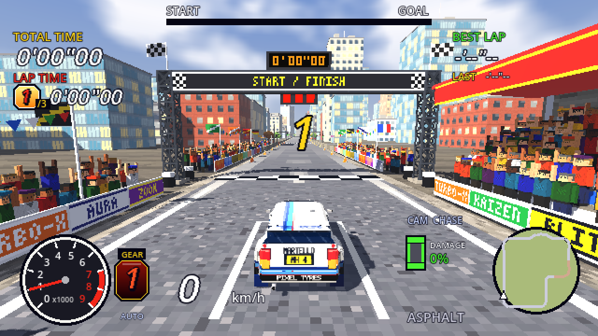

# Retro Rally (Godot 4 prototype)

Late-90s arcade rally in the spirit of Sega Rally / Colin McRae: chunky
640x360 render, nearest-filtered procedural textures, low-poly cars and
scenery, arcade HUD. The stages, textures, sky and sound are generated in
code; the vehicles are modelled in Blender (sources in `art/`, exported to
`models/*.glb`). The cars wear pixel-art skins from `models/`; the tank is
painted in code at startup.

## Open and play

1. Install Godot **4.7 or newer** (standard build, no .NET needed).
2. Godot Project Manager > **Import** > pick `project.godot` in this folder.
3. Press **F5** (Run Project). First launch takes a few seconds to build the stage.

## Controls

| Action | Keyboard | Gamepad |
|---|---|---|
| Throttle | W / Up (W only with the manual box) | RT or A |
| Brake / reverse (hold when stopped) | S / Down (S only with the manual box) | LT or X |
| Steer | A D / Left Right | Left stick, d-pad |
| Handbrake | Space | B |
| Change camera (Chase, Far chase, Hood, Bumper, TV) | C | Y |
| Reset onto road | R | Back |
| Shift up / down (manual gearbox) | Up / Down | RB / LB |
| Restart stage | T | |
| Arcade / modern look | F2 | |
| Pause / back | Esc | Start |

The same list is in the game: Esc > CONTROLS.

## Menu, records and ghosts

The game starts on the main menu. Pick a **stage**, a **car**, the number of
**laps** (1, 3 or 5), whether to race your **ghost**, the **weather**
(random, clear or rain) and the **gearbox** (automatic, or manual with the
Up / Down arrows), then START RACE. The gearbox can also be switched from the
pause menu. Random is rolled again for every
race from the menu (a restart keeps the same weather). Each launch starts on
1 lap, clear weather and the automatic gearbox; your picks hold until you quit.

- **Highscores:** the top 5 race times for each stage and lap count, plus the
  best lap for each stage. Make the top 5 and you enter arcade-style initials:
  up/down changes the letter, left/right moves, Enter confirms, or just type
  the letters.
- **Ghosts:** your fastest race on each stage and lap count is recorded and
  shows up as a see-through car next time. At every lap line you get a split
  against it: green `-0.85` means you're ahead, red `+1.20` means behind.
  It also shows as a blinking cyan dot on the minimap.
- **Pause** with Esc or Start: resume, restart, see the controls, or go back to
  the menu.
- Everything is saved in Godot's user folder. On Windows that's
  `%APPDATA%\Godot\app_userdata\Retro Rally\` (`records.json`, plus
  `ghosts/*.ghost`). Delete those files to reset your records.

## Cars

| Car | Style | Handling |
|---|---|---|
| Martello HF | Boxy Delta-style hatch with flared arches, Martini-style stripes | All-rounder |
| Saksen 777 | Blue Impreza-style saloon, gold wheels, bonnet scoop, big wing | Most grip, a bit less power |
| Balear Kit | Yellow Ibiza-style kit car, big roof spoiler, white wheels | Lightest rally car, sharpest turn-in |
| Peak F1 | Modern single-seater: halo, sidepods, multi-element wings, black with red and silver | About 225 km/h, fierce acceleration, downforce gives more grip the faster it goes; hopeless off the tarmac; fragile, wings snap off at a touch |
| Bongatti 27 | Low, wide mid-engined hypercar: bright blue nose and gunmetal tail split by a chrome C on each flank, horseshoe grille, full-width red light bar, louvred engine cover | Class S with the F1: a touch slower off the line, faster flat out (about 240 km/h), heavier and with less downforce, so it slides more in fast corners but shrugs off knocks better |
| Swamp King | Lime monster truck on huge knobbly tyres, tube frame and roll cage | Class X: bouncy long-travel suspension, rolls a lot, soaks up rough ground, big jumps |
| Holger Danske | Boxy Leopard-style tank in Danish angular three-tone camo, wedge turret, stabilised gun | Just for fun: slow, grippy, pivots on the spot, shrugs off most damage; skirts, lights and the turret basket get knocked off |

The rally cars are kept close (a few percent) so times stay comparable; the
F1, the hypercar and the tank are the odd ones out. The menu bars compare acceleration,
top speed, grip and turn-in across the whole garage.
Chassis forces (springs, brakes, steering assists) scale with each vehicle's
mass so an 800 kg F1 car and an 1800 kg tank both ride and turn sensibly; engine
power doesn't, so weight still counts.
Each car's handling, skin and breakable parts are listed in
`scripts/cars.gd`; `CarModel` loads the model and makes its panels dentable.
Records and ghosts set in cars that have since left the garage still show
their old names.

### Rebuilding the models

The cars come from `art/cars/build_cars.py`: run it in Blender's Scripting
tab (with `build_all("<path to this folder>")`) to rebuild their .blend files
and re-export `models/martello.glb`, `models/pleiad.glb`, `models/balear.glb`,
`models/veloce.glb` (the F1 car), `models/bellatrix.glb` (the hypercar) and
`models/swamp.glb` (the monster truck).

They all wear a skin painted in separate panel pieces (each side, top, front,
back, windscreen) in `art/cars/<car>_pieces/`, combined into
`models/<car>_skin.png`. `python art/cars/paint_skin.py <car>` recombines the
pieces (needs Pillow), so you can retouch any piece in a pixel editor such as
LibreSprite, Krita or GIMP and run it again; `--repaint` paints the pieces
from scratch. The builder writes `art/cars/<car>_layout.json` with every
face's outline in the skin.

The Holger Danske is `art/tank/leopard_tank.blend`, exported to `models/leopard.glb`;
its camouflage, crosses and number are painted in code (`TexGen.camo`,
`CarModel`).

## Stages

| Stage | Length | Character |
|---|---|---|
| Col de Pixel | 2.6 km | Mixed, about 1:45 a lap: tarmac village chicane, a gravel forest run with a tight hairpin and a crest jump, tarmac mountain hairpins climbing to 22 m, then gravel back down. Stone walls on the tarmac corners, hay bales on the gravel |
| Aquila Pass | 2.4 km, A to B | A point-to-point stage from the valley up to the col, about 2:00. Tarmac along the river, then a road cut into the cliffs over the gorge (a waterfall spills across it and wets the road), four gravel hairpins up the mountain face, the summit road along the top of a 150 m drop and ice below the pass. Rock walls on one side, a sheer drop with stone guard posts on the other; go over and you're put back on the road you fell from (the fall costs you the time) |
| Downtown GP | 2.0 km | A walled street circuit through a modern city: wide square corners, a chicane and a cobbled square, office blocks and shops, catch fences, traffic lights and a grandstand at the start |
| Jungle Temple | 2.1 km | Gravel and mud through dense rainforest (palms, vine-hung giants, ferns), over a plank bridge, through a river ford that slows you right down, past overgrown temples and a stepped pyramid |
| Monaco Ruins | 3.2 km | The Monaco GP street circuit after a nuclear war: Sainte Devote, Casino Square, the Grand Hotel hairpin, a half-collapsed tunnel, the chicane, the flooded swimming pool section and La Rascasse, past bombed-out blocks, wrecks and a toxic harbour |
| Pine Forest | 1.5 km | Gravel: fast and flowing through dense forest, two crests |
| Old Town | 1.1 km | Tarmac: tight town corners lined with houses and walls |
| Spa F1 | 3.1 km | Spa-Francorchamps: La Source, down to Eau Rouge and up Raidillon, the Kemmel straight, Les Combes, Bruxelles, a wet Pouhon, Stavelot, Blanchimont and the Bus Stop. Kerbs, armco and the Ardennes forest |
| Luna Base | 2.8 km | The Moon: low gravity, so the crests launch you; packed regolith and loose dust in the crater floors, past a lunar base with domes, landers and dishes, under a black sky with the Earth in it. Never rains |

Most stages are laps. A point-to-point stage (Aquila Pass) runs once from a
start to a finish somewhere else: the LAPS row reads A TO B, the HUD shows the
distance to go and gives split times against your ghost at three points on the
way, and its records (top 5, best run and ghost) are kept per stage and car
class like the others.

Stages are defined in `scripts/maps.gd`: a list of route points, surface
sections, elevation keyframes, jumps, a village range and forest density.
Copy an entry to make a new stage. Optional keys add a `theme` ("wasteland"
swaps the sky, houses, trees, barriers and cones; "jungle" brings palms,
temples and log barriers; "circuit" adds kerbs and armco; "moon" and "city"
dress the two stages above, "alpine" builds the mountain pass with
`scripts/cliff_road.gd`), `point_to_point`, a `gravity`, a `tunnel`,
`water` areas (route sections on "ford" dip under the water, sections on
"wood" become a bridge over it) and a `landmark` pyramid.

The surface table (`scripts/surfaces.gd`) has asphalt, gravel, wet, ice,
grass, mud, river (ford), wooden bridge, regolith, moon dust and cobbles
surfaces, each with its own grip,
slide, drag and roughness.

## Weather and tyre marks

- **Rain**: every surface loses grip (tarmac the most, about a quarter),
  roads go dark and shiny, all four tyres throw spray, rain streaks fall
  around the camera and the sky closes in. Headlights come on.
- **Tyre marks** (`scripts/skid_marks.gd`): sliding or spinning tyres leave
  black rubber on tarmac; gravel gets dug into ruts with ridges of thrown-up
  stones (a faint track even when you're just driving through, deep grooves
  when you drift); grass and mud get brown mud tracks; ice gets white
  scratches. The tank chews up everything.

## Handling model

Based on how arcade rally games and classic game car-physics write-ups do it:

- **Slip-angle tyres** (Marco Monster's "Car Physics for Games", simplified
  Pacejka): sideways force climbs steeply to a peak at a few degrees of slip,
  then falls off to a fraction of the peak, so slides are progressive and
  holdable rather than on/off. Tarmac peaks early and hard (crisp), gravel
  later and softer (floaty, drifty).
- **Weight transfer**: braking or lifting off moves grip to the front and
  takes it from the rear, accelerating does the opposite. Lift or brake into a
  corner and the tail comes round (lift-off oversteer / Scandinavian flick);
  engine braking makes lifting off count.
- **Arcade layer** (the Sega Rally approach: slides are part of going fast,
  and you don't get punished with an instant spin): a yaw-rate assist turns
  the car as much as the stick asks, within what the surface can plausibly
  give. Counter-steer catches slides, a drift-angle cap stops held slides
  from becoming spins, and the handbrake pivots the car for hairpins.
- Quick steering input (full lock in about 0.12 s on keys), with less lock
  the faster you go.

## Also in it

- **Damage** (`scripts/car_model.gd`): panels dent where hit and scuff;
  bumpers, the light pod, mirrors and the rear wing fall off. Front damage
  costs power and makes the engine smoke, side damage pulls the steering.
- **Cameras** (`scripts/camera_rig.gd`): chase, far chase, hood, bumper,
  trackside TV.
- **Arcade look** (`scripts/retro_look.gd`, F2 to switch): sunlight falls off
  across a surface in a few soft steps, the sun casts hard-edged shadows, the
  car's windows reflect a flat fake sky and the distance fades into a wall of
  depth fog. F2 swaps back to Godot's standard shading.
- **HUD** (`scripts/hud.gd`): total, lap and best times, a start-to-goal
  progress bar, tach with redline, gear, big italic speed, a minimap coloured
  by surface, and a damage diagram.
- **Sound** (`scripts/engine_synth.gd`, played by `scripts/engine_audio.gd`):
  all synthesised, no audio files. Each vehicle has its own engine: the
  Martello a raspy turbo four with anti-lag pops and a fluttering blow-off,
  the Saksen a burbling flat four, the Balear a revvy non-turbo four, the
  Peak a snarling V10 and the Holger Danske a deep, lumpy V12 diesel with
  rumbling, clanking tracks. The engine is band-limited to each profile's
  `top` so high revs never alias into whistles. Upshifts cut and bang,
  lifting off crackles, straight-cut gears whine. Tyres sound different on every surface (squeal on tarmac, crunch on
  gravel, spray in the wet, swish on grass), plus wind, rain on the body,
  crashes and landings. The bonnet and bumper cameras hear more intake and
  road. `tools/audio_preview.gd` renders it all to WAV files to listen to
  without driving:
  `godot --headless --path . --script res://tools/audio_preview.gd -- <out dir>`.

## Code layout

Everything is built in code from two tiny scenes (`menu.tscn`, `main.tscn`);
the scripts are in `scripts/`:

| Script | What it does |
|---|---|
| `game_state.gd` | Autoload `Game`: menu choices, input bindings, highscores and ghosts on disk |
| `menu.gd`, `race_menu.gd`, `hud.gd`, `retro_ui.gd` | Main menu, pause / initials / results overlay, race HUD, shared drawing helpers |
| `main.gd` | The race: builds stage, car, camera and HUD, runs countdown, laps, ghost and finish |
| `maps.gd`, `track_builder.gd`, `start_area.gd`, `trees.gd` | Stage definitions and the code that turns one into road, terrain, scenery and the start/finish dressing |
| `cliff_road.gd` | The mountain pass: terrain with drops and rock walls, cliff faces, guard posts, the waterfall |
| `surfaces.gd`, `conditions.gd` | Surface grip table; weather, lighting and sky |
| `cars.gd`, `car.gd`, `car_model.gd` | The garage, the raycast car physics, the model with its dents and breakable parts |
| `camera_rig.gd`, `skid_marks.gd`, `ghost.gd` | Cameras, tyre marks, ghost recording and playback |
| `engine_synth.gd`, `engine_audio.gd` | Synthesised sound and the player that feeds it the car's state |
| `retro_look.gd` | The arcade shading (F2) |
| `tex_gen.gd`, `geo.gd` | Procedural pixel textures and the pixel font; mesh winding helpers |

`tools/audio_preview.gd` renders the sound offline, and `art/` (ignored by
Godot) holds the Blender sources and skin painter.

## Tuning tips

- Surface feel: edit the table in `scripts/surfaces.gd`.
- Car power, gearing, steering, suspension, assists: constants at the top of
  `scripts/car.gd` (`YAW_ASSIST` = how eagerly it turns, `WEIGHT_TRANSFER`,
  `DRIFT_CAP`, `STEER_LOW/HIGH`).
- Stage layouts: `scripts/maps.gd`.
- Pixel chunkiness: `display/window/size/viewport_width/height` in Project
  Settings (480x270 is chunkier, 960x540 is cleaner).
